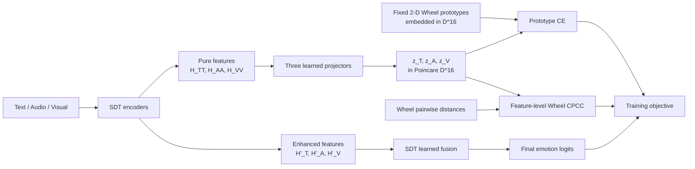

# Phương pháp gốc: SDT + Fixed Poincaré Emotion Wheel (75.31 Weighted F1)

## 1. Phạm vi của tài liệu

Tài liệu này mô tả đúng cấu hình gốc `P-PC`, còn được gọi là `TRUE-PC`, đã
đạt kết quả sau trên IEMOCAP:

| Chỉ số | Kết quả |
|---|---:|
| Best epoch | 56 |
| Test Accuracy | 75.1078 |
| Test Weighted F1 | **75.3062** |
| Test Macro F1 | 74.6200 |

Đây là kết quả của seed `2024`, với checkpoint được chọn bằng **test weighted
F1**, theo protocol SDT gốc. Vì test set được dùng để chọn epoch, con số này
phù hợp để tái lập và so sánh với các run SDT cũ, nhưng không nên được xem là
ước lượng hoàn toàn unbiased. Khi báo cáo kết quả cuối cùng, nên bổ sung protocol
chọn checkpoint bằng validation và chạy nhiều seed.

Điểm quan trọng nhất là phương pháp này **không học prototype**. Emotion Wheel
prototype là các điểm cố định. Phần được học là:

- SDT backbone;
- ba projector từ feature Text/Audio/Visual sang Poincaré ball;
- classifier và fusion gate vốn có của SDT.

Các thử nghiệm free prototype, modality-specific prototype, data prototype,
multi-prototype và prototype-evidence fusion không thuộc phương pháp này.

## 2. Tóm tắt phương pháp

Phương pháp giữ nguyên SDT làm nhánh dự đoán chính, sau đó thêm hai loss phụ từ
Emotion Wheel:

1. **Wheel Prototype CE**: kéo feature của từng modality về fixed prototype
   tương ứng với nhãn thật.
2. **Wheel CPCC**: buộc khoảng cách giữa các utterance trong Poincaré ball có
   tương quan với khoảng cách ngữ nghĩa trên Emotion Wheel.

Luồng tổng quát:



Ở cấu hình `tical-mode=observe`, prototype logits không được cộng vào final
logits và TiCAL không thay đổi fusion weights. Do đó, tại inference:

\[
\hat y = \operatorname{argmax} f_{\mathrm{SDT}}(x),
\]

còn Emotion Wheel chỉ định hình representation trong quá trình train.

## 3. SDT backbone và feature được Wheel regularize

SDT tạo hai loại representation cho mỗi modality:

- pure self-modal features:
  \(H_{TT},H_{AA},H_{VV}\);
- enhanced features sau tương tác multimodal:
  \(H'_T,H'_A,H'_V\).

Cấu hình 75.31 sử dụng:

```text
fusion_feature_source = enhanced
wheel_feature_source  = pure
```

Vì vậy:

- final classifier và SDT fusion sử dụng \(H'_T,H'_A,H'_V\);
- hai Wheel loss được gắn vào \(H_{TT},H_{AA},H_{VV}\).

Ba projector của Text, Audio và Visual độc lập với nhau:

\[
u_i^m=W_m h_i^m+b_m,\qquad m\in\{T,A,V\},
\]

sau đó dùng exponential map tại gốc để đưa vector vào Poincaré ball:

\[
z_i^m=\operatorname{Exp}_0(u_i^m)
=\tanh(\lVert u_i^m\rVert)
\frac{u_i^m}{\lVert u_i^m\rVert}
\in\mathbb D^{16}.
\]

Sample radius được để tự do (`wheel_radius_mode=free`). Vì vậy mỗi utterance có
thể học cả:

- hướng trong không gian;
- bán kính \(\lVert z_i^m\rVert<1\).

Wheel losses không detach feature trong cấu hình gốc. Gradient đi qua projector
và tiếp tục cập nhật SDT encoder.

## 4. Fixed Emotion Wheel prototypes

### 4.1 Thứ tự class của IEMOCAP

Label index trong code là:

| Index | Emotion |
|---:|---|
| 0 | happy |
| 1 | sad |
| 2 | neutral |
| 3 | angry |
| 4 | excited |
| 5 | frustrated |

Thứ tự được đặt trên vòng tròn là:

```text
happy -> excited -> angry -> frustrated -> sad -> neutral -> happy
```

Do đó:

| Emotion | Góc \(\theta_c\) |
|---|---:|
| happy | \(0\) |
| excited | \(\pi/3\) |
| angry | \(2\pi/3\) |
| frustrated | \(\pi\) |
| sad | \(4\pi/3\) |
| neutral | \(5\pi/3\) |

### 4.2 Tọa độ prototype

Với \(D=16\) và bán kính cố định \(r=0.75\), prototype của class \(c\) là:

\[
p_c=
[r\cos\theta_c,\;r\sin\theta_c,\;0,\ldots,0]
\in\mathbb D^{16}.
\]

Đây là một shared bank duy nhất cho cả ba modality:

\[
P=\{p_c\}_{c=1}^{6}.
\]

Nó được đăng ký dưới dạng buffer, không phải `nn.Parameter`. Vì vậy:

- tọa độ không được optimizer cập nhật;
- bán kính luôn bằng 0.75;
- góc và thứ tự cảm xúc luôn giữ nguyên;
- Text, Audio và Visual đều được kéo về cùng một semantic reference frame.

Tên cấu hình tương ứng trong code là:

```text
wheel_prototype_layout      = fixed-wheel
wheel_prototype_radius_mode = fixed-shared
wheel_prototype_radius      = 0.75
```

### 4.3 Ý nghĩa của D=16

Prototype nằm trong mặt phẳng tạo bởi hai chiều đầu, nhưng sample embedding
\(z_i^m\) vẫn là vector D=16 và các chiều 3--16 không bị ép bằng 0.

Khoảng cách từ một sample đến prototype vẫn sử dụng đủ 16 chiều. Do đó các
chiều residual làm tăng khoảng cách tới mặt phẳng prototype và nhận gradient từ
Prototype CE cũng như CPCC.

Nói chính xác, cấu hình này là:

> **feature space Poincaré 16D với một semantic Wheel plane cố định 2D**, không
> phải một Emotion Wheel có ngữ nghĩa độc lập trên cả 16 chiều.

Đây chính là giới hạn đã thúc đẩy các thử nghiệm prototype learning về sau.
Tuy nhiên, fixed plane cũng tạo ra một reference frame ổn định và có tác dụng
regularization mạnh; đó là một lý do quan trọng khiến baseline này tổng quát hóa
tốt hơn nhiều cấu hình free prototype.

## 5. Khoảng cách Poincaré

Với curvature \(-1\), khoảng cách giữa hai điểm \(x,y\in\mathbb D^{16}\) là:

\[
d_{\mathbb D}(x,y)
=\operatorname{arcosh}\left(
1+2\frac{\lVert x-y\rVert^2}
{(1-\lVert x\rVert^2)(1-\lVert y\rVert^2)}
\right).
\]

Khoảng cách tăng nhanh khi điểm tiến gần biên của ball. Điều này cho phép mô
hình biểu diễn đồng thời hướng và mức độ radial, thay vì chỉ dùng khoảng cách
Euclidean trên một đường tròn.

## 6. Wheel Prototype CE

Đối với modality \(m\), khoảng cách từ utterance \(i\) tới prototype class
\(c\) là:

\[
d_{i,c}^m=d_{\mathbb D}(z_i^m,p_c).
\]

Prototype logits được tính bằng khoảng cách âm:

\[
s_{i,c}^m=-\frac{d_{i,c}^m}{\tau},
\qquad \tau=1.0.
\]

Loss cho ba modality:

\[
L_{\mathrm{proto}}
=\frac{1}{3}\sum_{m\in\{T,A,V\}}
\operatorname{CE}(s^m,y).
\]

Tác dụng của loss này là:

- kéo sample về prototype đúng;
- đẩy sample ra xa prototype sai thông qua softmax CE;
- dùng cùng một fixed bank để căn chỉnh semantic space của ba modality;
- cung cấp supervision class-wise trực tiếp cho từng pure modality feature.

Prototype CE không thay thế classifier SDT. Nó chỉ là auxiliary loss.

## 7. Feature-level Wheel CPCC

Prototype CE chỉ yêu cầu class đúng gần hơn các class sai. Wheel CPCC bổ sung
ràng buộc cho toàn bộ cấu trúc khoảng cách giữa các sample.

Khoảng cách semantic giữa class \(a\) và \(b\) trên Emotion Wheel là shortest
circular distance, được chuẩn hóa về \([0,1]\):

\[
\delta_W(a,b)
=\frac{\arccos(\cos(\theta_a-\theta_b))}{\pi}.
\]

Với tất cả cặp utterance hợp lệ \((i,j)\) trong batch, ta tạo hai vector:

\[
g_{ij}^m=d_{\mathbb D}(z_i^m,z_j^m),
\qquad
w_{ij}=\delta_W(y_i,y_j).
\]

CPCC loss của modality \(m\) là:

\[
L_{\mathrm{CPCC}}^m
=1-\operatorname{corr}(g^m,w),
\]

và loss cuối cùng là trung bình ba modality:

\[
L_{\mathrm{CPCC}}
=\frac{1}{3}\sum_{m\in\{T,A,V\}}L_{\mathrm{CPCC}}^m.
\]

Khác với categorical contrastive loss chỉ biết “cùng class/khác class”, Wheel
CPCC phân biệt được mức độ gần xa. Ví dụ, hai cảm xúc đứng cạnh nhau trên Wheel
được kỳ vọng gần hơn hai cảm xúc nằm đối diện nhau.

CPCC ở đây được tính trên **projected sample features**, không phải CPCC giữa
các prototype. Các prototype đã fixed nên không cần prototype-structure loss.

## 8. Hàm mục tiêu đầy đủ

SDT loss gốc gồm:

\[
L_{\mathrm{SDT}}
=\gamma_1L_{\mathrm{task}}
+\gamma_2L_{\mathrm{student}}
+\gamma_3L_{\mathrm{KD}},
\]

với:

```text
gamma_1 = gamma_2 = gamma_3 = 1
```

Trong đó:

- \(L_{\mathrm{task}}\): weighted CE/NLL của final multimodal prediction;
- \(L_{\mathrm{student}}\): tổng weighted CE/NLL của ba unimodal student;
- \(L_{\mathrm{KD}}\): distillation từ multimodal teacher sang ba student.

Objective của cấu hình 75.31 là:

\[
\boxed{
L
=L_{\mathrm{SDT}}
+0.1L_{\mathrm{proto}}
+0.05L_{\mathrm{CPCC}}
}
\]

Các term khác đều tắt:

```text
lambda_hyp              = 0
lambda_co               = 0
lambda_reg              = 0
lambda_reliability      = 0
lambda_wheel_radius     = 0
lambda_wheel_structure  = 0
lambda_wheel_alignment  = 0
lambda_wheel_boundary   = 0
lambda_data_prototype   = 0
prototype_evidence      = none
wheel_uncertainty       = none
```

Không có warm-up/ramp riêng cho hai Wheel loss trong cấu hình gốc. Chúng tác
động ngay từ đầu:

```text
prototype_loss_warmup_epochs = 0
prototype_loss_ramp_epochs   = 0
```

## 9. Vai trò thực tế của `tical-mode=observe`

Đây là điểm rất dễ hiểu nhầm.

TiCAL vẫn tạo ba historical anchor banks và có thể tính typicality/kappa sau
warm-up. Tuy nhiên với `tical-mode=observe`:

- kappa không reweight knowledge distillation;
- typicality không thay đổi SDT fusion;
- generic Hyp-CPCC bị tắt vì `lambda_hyp=0`;
- anchor-bank query không tham gia Wheel Prototype CE;
- anchor-bank query không tham gia Wheel CPCC;
- final logits vẫn là logits của SDT.

Vì vậy cải thiện 75.31 nên được quy cho **hai Emotion Wheel losses tác động lên
representation**, không nên quy cho TiCAL fusion hoặc historical anchor bank.

`tical_warmup_epochs=10` vẫn cần giữ khi muốn tái lập đúng run, vì nó là một
phần của cấu hình và có thể làm thay đổi tiến trình anchor bookkeeping/RNG.

## 10. Tại sao phương pháp có thể cải thiện SDT

Hai loss bổ sung hai dạng inductive bias khác nhau:

### 10.1 Prototype CE cung cấp absolute semantic targets

Mỗi class có một đích cố định. Projector và encoder phải đưa sample tới một vị
trí semantic nhất quán, thay vì tự do quay hoặc trôi cùng classifier.

### 10.2 CPCC bảo toàn relative emotion structure

CPCC không chỉ yêu cầu phân lớp đúng mà còn yêu cầu cấu trúc gần-xa của toàn bộ
batch khớp Emotion Wheel.

### 10.3 Shared fixed bank căn chỉnh ba modality

Ba projector khác nhau nhưng cùng nhìn vào một prototype bank. Text, Audio và
Visual không thể tự học ba hệ tọa độ class hoàn toàn độc lập.

### 10.4 `observe` tránh làm hỏng SDT inference path

Prototype branch không trực tiếp cộng logits vào classifier. Nếu prototype
classifier của Audio hoặc Visual còn yếu, nó vẫn có thể đóng vai trò auxiliary
regularizer mà không trực tiếp kéo sai final prediction.

## 11. Hạn chế của phương pháp gốc

Phương pháp đạt kết quả tốt nhưng có các giới hạn rõ ràng:

1. Prototype chỉ có semantic coordinates trong hai chiều đầu.
2. Các chiều 3--16 của prototype luôn bằng 0.
3. Tất cả class dùng cùng bán kính 0.75.
4. Prototype không thích nghi với distribution thực tế của từng modality.
5. Emotion Wheel order là prior thủ công.
6. Kết quả 75.31 hiện là một seed và dùng test-selection protocol.

Điểm 1--4 là động lực hợp lý cho prototype learning. Tuy nhiên các prototype
learnable hoàn toàn tự do làm mất fixed semantic reference và có thể co-adapt
với projector. Vì vậy, một phương pháp mới chỉ nên được coi là cải thiện nếu nó
giải quyết giới hạn full-D/fixed mà vẫn giữ được khả năng regularization và đạt
kết quả ổn định qua nhiều seed.

## 12. Cấu hình tái lập 75.31

Các hyperparameter chính:

| Nhóm | Giá trị |
|---|---|
| Dataset | IEMOCAP |
| Seed | 2024 |
| Selection protocol | test |
| Epochs | 150 |
| Batch size | 16 |
| Hidden dimension | 1024 |
| Attention heads | 8 |
| Learning rate | `1e-4` |
| Weight decay/L2 | `1e-5` |
| Dropout | 0.5 |
| SDT temperature | 1 |
| Geometry | Poincaré, curvature -1 |
| Hyperbolic dimension | 16 |
| Sample radius | free |
| Prototype layout | fixed-wheel |
| Prototype radius mode | fixed-shared |
| Prototype radius | 0.75 |
| Wheel temperature | 1.0 |
| Wheel feature source | pure |
| Fusion feature source | enhanced |
| `lambda_wheel_proto` | 0.1 |
| `lambda_wheel_cpcc` | 0.05 |
| TiCAL mode | observe |
| TiCAL warm-up | 10 epochs |
| Anchor size | 2048 |
| Anchor confidence threshold | 0.8 |
| DataLoader workers | 0 |
| PyTorch threads | 0/default |

Số DataLoader worker cần được giữ đúng nếu muốn tái lập chính xác seed 2024.
Thay đổi worker count có thể làm thay đổi thứ tự mini-batch/RNG và tạo ra kết
quả hơi khác dù seed không đổi.

## 13. Cách chạy trên server

### 13.1 Tái lập riêng radius 0.75

Từ thư mục project trên server:

```bash
cd /mnt/users/26anh.vl/MERC/SDT_reliability_freeproto

PYTHON=~/_container_layer_20261108/miniconda3/envs/mmrec/bin/python3.12 \
GPU_ID=0 \
SEEDS="2024" \
RADII="0.75" \
SELECTION_PROTOCOL=test \
WARMUP_EPOCHS=10 \
NUM_WORKERS=0 \
NUM_THREADS=0 \
OUTPUT_DIR="$PWD/results/fixed_wheel_75_31_reproduction" \
bash experiment/wheel_prototype_radius_ablation/run_fixed_radius_sweep.sh \
  --device cuda --gpu-id 0
```

Lệnh này chạy đúng `P-PC/TRUE-PC`, D=16, fixed prototype radius 0.75 và cả hai
Wheel loss.

Nếu interactive allocation chỉ expose đúng một GPU, dùng `--gpu-id 0` để chọn
GPU đầu tiên trong session, kể cả physical GPU được scheduler cấp có ID khác.

### 13.2 Chạy nhanh bằng wrapper Wheel-only

```bash
PYTHON=~/_container_layer_20261108/miniconda3/envs/mmrec/bin/python3.12 \
bash exec_iemocap_wheel_only.sh \
  --device cuda --gpu-id 0 \
  --seed 2024 \
  --selection-protocol test \
  --tical-warmup-epochs 10 \
  --num-workers 0 \
  --num-threads 0 \
  --output-dir "$PWD/results/fixed_wheel_75_31_direct"
```

Lưu ý: không chạy riêng `exec_iemocap_tical_wheel.sh` rồi cho rằng đó là cấu
hình 75.31, vì wrapper đó mặc định đặt `hyperbolic_dim=2`. Wrapper
`exec_iemocap_wheel_only.sh` override lại thành D=16.

### 13.3 Chạy nhiều seed

```bash
PYTHON=~/_container_layer_20261108/miniconda3/envs/mmrec/bin/python3.12 \
GPU_ID=0 \
SEEDS="2024 2025 2026 2027 2028" \
RADII="0.75" \
SELECTION_PROTOCOL=validation \
WARMUP_EPOCHS=10 \
NUM_WORKERS=0 \
NUM_THREADS=0 \
OUTPUT_DIR="$PWD/results/fixed_wheel_d16_multiseed" \
bash experiment/wheel_prototype_radius_ablation/run_fixed_radius_sweep.sh \
  --device cuda --gpu-id 0
```

Nên dùng `SELECTION_PROTOCOL=validation` cho đánh giá nghiên cứu chính thức.

## 14. Vị trí implementation trong code

| Thành phần | File/function |
|---|---|
| Emotion order và class angles | `tical.py::emotion_wheel_angles` |
| Circular Wheel distance | `tical.py::circular_class_distance_matrix` |
| Fixed prototype construction | `geometry_analysis/geometry.py::wheel_prototypes` |
| Poincaré projector | `geometry_analysis/geometry.py::GeometryProjector` |
| Poincaré distance | `geometry_analysis/geometry.py::geometry_distance` |
| Prototype logits | `geometry_analysis/geometry.py::geometry_prototype_outputs` |
| Feature CPCC | `geometry_analysis/geometry.py::geometry_cpcc_loss` |
| Wheel forward outputs | `tical.py::TiCALModule.forward` |
| Prototype CE và CPCC integration | `losses.py::SDTCOLDLoss.forward` |
| Gắn Wheel vào pure features | `model.py::Transformer_Based_Model.forward` |
| Runner `P-PC` | `geometry_analysis/run_ablation.sh` |
| Runner tái lập radius 0.75 | `experiment/wheel_prototype_radius_ablation/run_fixed_radius_sweep.sh` |

## 15. Checklist xác nhận một run đúng phương pháp gốc

Trong `summary.json` hoặc saved arguments, cần thấy:

```text
dataset                         = IEMOCAP
fusion_variant                  = sdt
fusion_feature_source           = enhanced
wheel_feature_source            = pure
tical_mode                      = observe
use_emotion_wheel               = true
wheel_geometry                  = poincare
hyperbolic_dim                  = 16
wheel_radius_mode               = free
wheel_prototype_layout          = fixed-wheel
wheel_prototype_radius_mode     = fixed-shared
wheel_prototype_radius          = 0.75
wheel_temperature               = 1.0
lambda_wheel_proto              = 0.1
lambda_wheel_cpcc               = 0.05
lambda_hyp                      = 0
use_data_prototypes             = false
replace_fixed_wheel_prototypes  = false
prototype_evidence_fusion       = none
wheel_uncertainty_mode          = none
```

Nếu xuất hiện `freeproto`, `modalityproto`, `sharedprivateproto`, `dualdata`,
`learnedwheel`, `protofusion` hoặc `j2` trong run name, đó không còn là phương
pháp gốc 75.31.

## 16. Mô tả ngắn có thể dùng trong paper

> We augment the deterministic SDT model with an auxiliary Poincaré Emotion
> Wheel regularizer. Pure text, audio, and visual representations are mapped
> by modality-specific projectors into a 16-dimensional Poincaré ball. Six
> fixed class prototypes are placed at radius 0.75 according to the semantic
> order of the emotion wheel in a shared two-dimensional subspace. Training
> combines the original SDT objective with a distance-based prototype
> cross-entropy loss and a CPCC loss that aligns pairwise hyperbolic feature
> distances with circular emotion-wheel distances. The prototype branch is
> used only as an auxiliary training signal; final inference retains the
> original SDT fusion and classifier.

